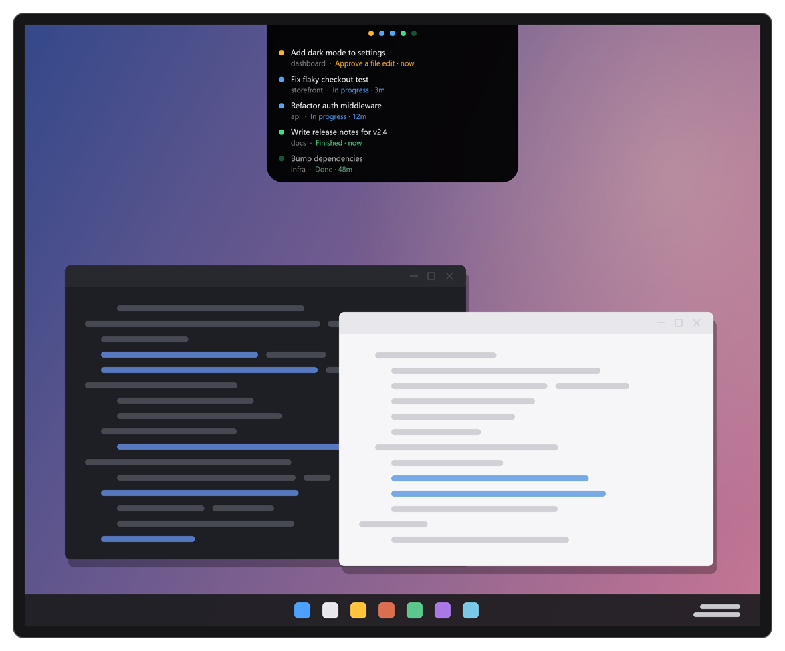
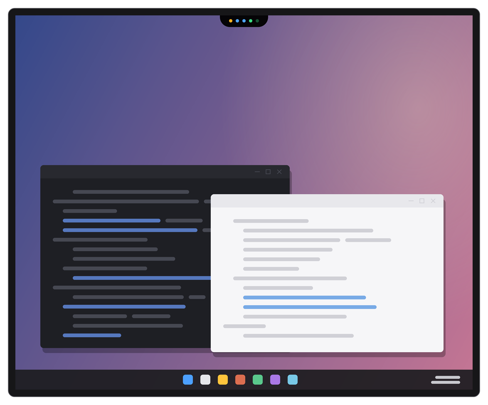
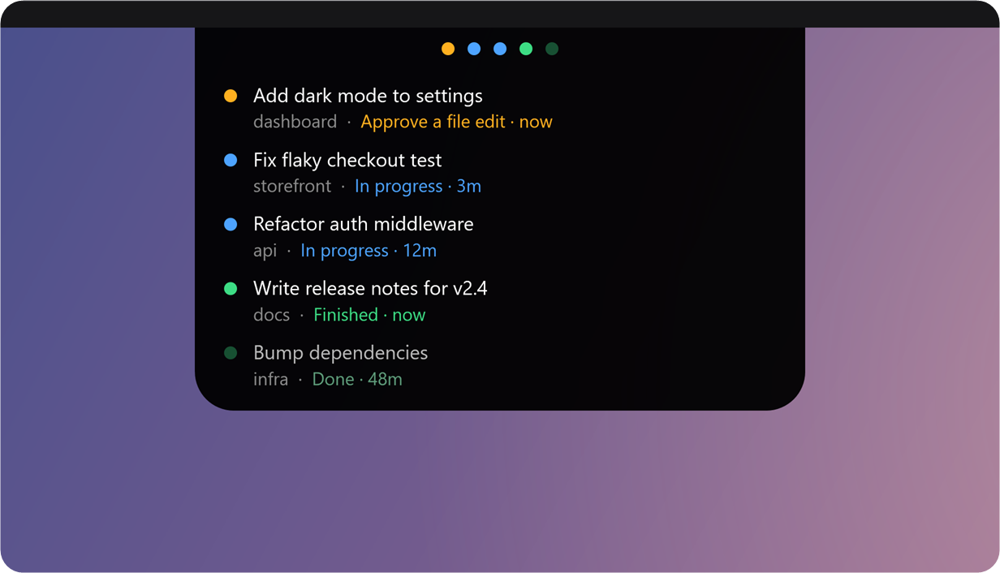
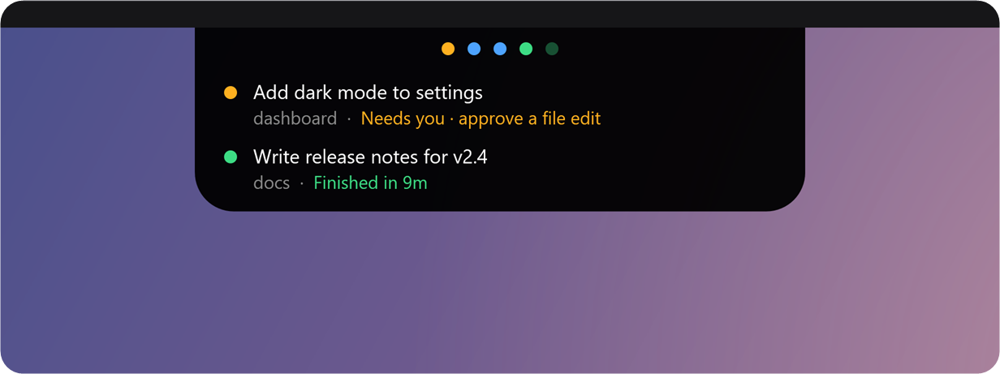
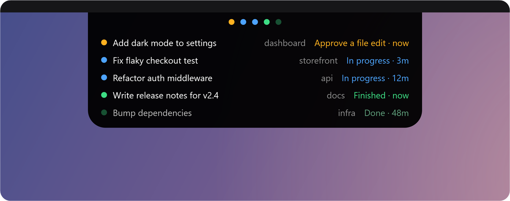

# BotBar

A small notch at the top of your screen that shows what every Claude Code session is doing.

Running several Claude sessions at once usually means flipping between windows to find out which one is still working, which one finished, and which one is stuck on a permission prompt. BotBar puts all of them in one place and lets you know when something changes.

It works with both the **Claude desktop app** and the **Claude Code CLI**.

## Getting started

You need Windows 10 or 11 and Claude Code. There's nothing to install and nothing to configure.

1. Clone this repo, or download the ZIP and unzip it somewhere permanent.
2. Double-click **`BotBar.vbs`**.

The notch appears at the top of your main monitor. To start it every time you log in, right-click it and tick **Start with Windows**.

> **Windows blocked the script?** Right-click `BotBar.vbs` → **Properties** → tick **Unblock**.

## Reading the dots

Each dot is one session.

| Colour | Meaning |
| --- | --- |
| 🟠 Amber | Waiting on you: a permission prompt or a question |
| 🔵 Blue | Working |
| 🟢 Green | Just finished, and you haven't looked yet |
| Dim green | Finished, and you've seen it |

Most of the time, the row of dots is all you see:

With more than eight sessions, the dots switch to a count per colour so the notch stays small.

## Using it

**Hover** over the notch to open the full list.

**Click** a session to jump to it:

- A desktop-app session opens in the Claude app.
- A CLI session brings its terminal window to the front. If that window has several tabs, you'll still need to pick the right tab.

**Alerts.** When a session finishes or needs you, the notch drops down for a few seconds and plays a short chime: three rising notes for "finished", a two-note doorbell for "needs you".

**Staying out of the way.** When nothing is happening, the notch shrinks and dims. After a few quiet minutes it slides off the top of the screen. Move the mouse to where it was and it comes back. It also hides under fullscreen games and videos, unless you tell it not to.

## Settings

**Move it** by dragging the notch along the top edge of any monitor. It remembers where you left it.

**Right-click** the notch for everything else:

| Option | What it does |
| --- | --- |
| Snap to | Put it back at the left, centre or right |
| Lock position | Stop accidental drags |
| Show completed sessions | Turn off to see only what's working or waiting |
| Two-line rows | Turn off for a denser one-line list (below) |
| Shrink and dim when idle | Make the notch small and faint when nothing needs you |
| Fullscreen apps | Hide under games and videos, or stay on top of them |
| Slide away when idle | After 5 or 10 quiet minutes, or never |
| Play a sound on alerts | Turn the chimes on or off. **Preview sounds** plays them |
| Mark all as seen | Dim every green dot at once |

Your settings are saved in `BotBar.settings.json`, next to the script.

## Good to know

- **Session names** come from Claude Code. Unnamed CLI sessions get a short generated name like `botbar-a4`. Sessions with no name show their project folder.
- **One copy at a time.** Double-clicking `BotBar.vbs` while it's running does nothing.
- **To quit**, right-click → **Exit BotBar**.
- **To uninstall**, untick **Start with Windows**, quit, then delete the folder.
